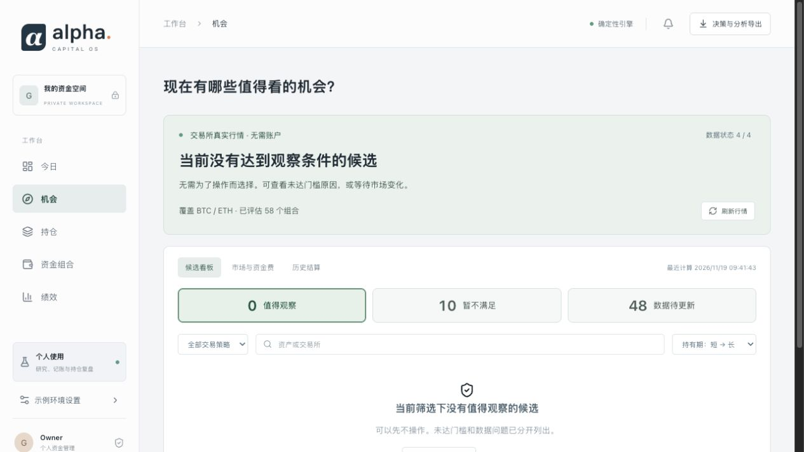
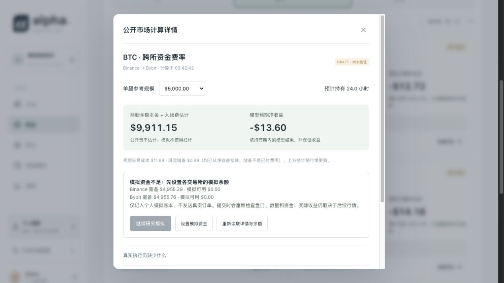
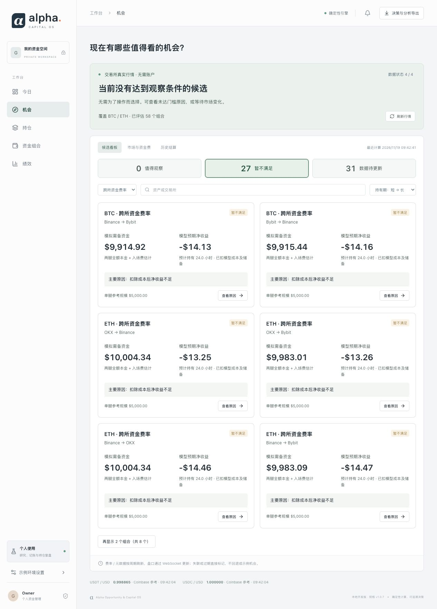

# AlphaIntel · Alpha Opportunity & Capital OS

**本地运行的加密资产机会研究与个人资金工作台。** 使用交易所公开行情比较资金费、期现基差和跨所价差，提供可追溯计算、真实行情模拟与手动记账，无需交易所 API Key。

A local-first crypto market research dashboard with public exchange data, auditable calculations, paper trading and a personal ledger. No exchange API keys required.

[快速开始](#快速开始) · [界面预览](#界面预览) · [个人使用说明](docs/PERSONAL-USE.md) · [API 文档](docs/PUBLIC-MARKET-API.md) · [参与贡献](CONTRIBUTING.md) · [MIT License](LICENSE)

> 当前是个人研究与模拟版本，不是自动交易机器人。不会发送真实订单；模型预期收益不等于已实现利润或经过验证的投资收益。策略保持 `DRAFT / UNPROVEN`。

## 能做什么

| 功能 | 当前能力 |
| --- | --- |
| 公开行情 | OKX、Binance、Bybit、Hyperliquid；REST 元数据与历史资金费、WebSocket 盘口；默认 BTC / ETH |
| 机会研究 | 资金费率中性、期现基差、跨所资金费率、跨所现货价差；区分值得观察、未达门槛和数据待更新 |
| 透明计算 | 双腿数量匹配、合约乘数、VWAP、滑点、费用估计、风险储备、资金占用、持有期与按规模计算 |
| 研究模拟 | 三类带衍生品的组合按真实盘口模拟，两腿全额预留本金；行情、数量或资金检查失败则整笔拒绝 |
| 个人账本 | 模拟与手动记账分离；资金流水、成交、手续费、资金费、持仓提示和分项绩效 |
| 可追溯导出 | 导出计算输入、参数版本、公式事实和账本结果，支持确定性复算 |

跨所现货价差可研究，但需要预置现货库存，当前不支持这类模拟。闲置生息仅提供条款计算接口，尚未连接私人产品条款。连接正常也不保证每个候选的数据仍在有效期内。

## 界面预览

以下截图于 **2026-11-19（Asia/Shanghai）** 从隔离的本地实例采集：使用当时的公开行情，模拟余额为零。截图不是当前报价或收益承诺；“没有值得观察的候选”和负收益结果均为正常状态。

**机会总览：先看当前结论与数据状态。**



**计算详情：比较两腿资金、持有期、费用和限制，再决定是否模拟。**



<details>
<summary>展开查看候选卡片列表</summary>



</details>

截图来源与重拍说明见 [截图说明](docs/screenshots/README.md)。

## 快速开始

需要 **Node.js 20.19+** 和 npm，且本机网络可以访问上述交易所及 Coinbase 的公开接口。当前提供中文界面；终端示例适用于 macOS / Linux / WSL。

```sh
git clone https://github.com/coverme128/alphaIntel.git
cd alphaIntel
npm ci
npm run build
ALPHA_PUBLIC_AUTOSTART=true npm start
```

打开 **http://127.0.0.1:4317/#Opportunities**。启动后等待行情与历史数据加载，检查“最近计算”和数据状态；数据缺失或过期时不会用示例机会替代。

开发模式支持前端热更新：

```sh
ALPHA_PUBLIC_AUTOSTART=true npm run dev
```

不设置自动连接时，可在“机会”点击“连接公开市场”。以后使用已构建版本只需运行 `ALPHA_PUBLIC_AUTOSTART=true npm start`，保持终端运行；按 `Ctrl+C` 结束服务。更新代码后重新安装依赖并构建。

## 第一次使用

1. **只看行情与机会**：无需注册账户、填写密钥或录入资金。
2. **研究模拟**：在“资金组合 → 真实行情模拟”录入各交易所的模拟资金；到“机会”选择规模、核对资金和限制后继续模拟。这里只记模拟账，不充值或转账。
3. **手动记账**：选择“个人手动记账”，录入自己已发生的成交、实际手续费和资金流水。
4. **复盘**：在“持仓”看估值与提醒，在“绩效”区分已实现价差、资金费、费用和未实现损益。

个人账本初始资金为零。旧版示例演练的 **100,000 USD** 为固定演示数据，与个人账本隔离。详见 [个人使用说明](docs/PERSONAL-USE.md)。

## 配置与数据

无需密钥，也无需数据库或大模型服务。配置由**启动进程的环境变量**提供；应用**不会自动读取 `.env`**。[`.env.example`](.env.example) 仅列出非敏感配置示例。

| 环境变量 | 默认值 | 用途 |
| --- | --- | --- |
| `PORT` | `4317` | 本机 HTTP 端口 |
| `ALPHA_PUBLIC_AUTOSTART` | 不自动连接 | 设为 `true` 后启动公开行情采集 |
| `ALPHA_ASSETS` | `BTC,ETH` | 逗号分隔的资产符号；其他资产取决于适配器及市场可用性 |
| `ALPHA_DATA_DIR` | `.data` | 本地账本及公开行情状态的保存目录 |

```sh
ALPHA_PUBLIC_AUTOSTART=true ALPHA_ASSETS=BTC,ETH PORT=4317 npm start
```

- 市场参数和保守费用假设位于 [`config/public-market.json`](config/public-market.json)，修改后重启。公开费用估计不代表个人账户的实际费率。
- 账本及缓存保存在 `.data/`，已忽略 Git 跟踪。不要多个实例同时写同一数据目录；删除目录会丢失本地记录。
- 服务仅监听 `127.0.0.1`，面向单人本机使用，没有面向公网部署的账户认证与隔离设计。
- `specs/` 保存原始 v1.0.7 规格，包含未来生产架构和配置示例，**不代表当前版本已实现，也不是当前运行时配置**。
- 导出 JSON 可能包含个人资金、持仓与成交记录；分享前自行脱敏。不要把 `.data/`、实际 `.env` 或导出账本提交到仓库。

## 开发与验证

技术栈：**React 19 · TypeScript · Vite 6 · Express 4**。当前使用本地 JSON 原子写入保存账本，没有部署数据库的前置要求。

```sh
npm run check              # 单元 / 接口测试 + TypeScript 检查 + 前端构建
npm run security:check     # 当前文件及暂存内容的脱敏规则扫描
npm run security:history   # 另扫描本地全部引用及 reflog 可达的历史文件
npm run market:check -- /tmp/alpha-public-market-snapshot.json
npm run replay -- docs/replay-example.json /tmp/alpha-replay-report.json
```

`market:check` 需要联网；`replay` 使用已归一化输入复算，不等于完整订单簿撮合或长周期收益验证。扫描器是启发式防误提交检查，不保证发现所有类型的凭据；范围和限制见 [安全说明](SECURITY.md)。

```text
src/client/      中文界面、个人工作台与机会看板
src/market/      公开数据适配器、WebSocket、历史数据与策略计算
src/domain/      确定性公式、分配约束、轮动规则与回放
src/personal/    模拟及手动账本、估值与结算
src/server/      本地 API、持久化与导出
config/          版本化策略与费用假设
scripts/         联网检查、回放与敏感信息扫描
tests/           Golden Fixtures、计算与 HTTP 接口测试
docs/            使用、API、架构、验收状态与截图
specs/           原始规格与未来生产交付参考
```

## 当前边界

尚未实现私有账户同步、真实下单、真实成交对账、保证金与强平计算、私有理财条款接入。持仓提醒仅显示在页面，不会自动退出或发送后台通知；长时间离线期间的数据不能视为完整。

实盘还需要交易执行状态机、失败恢复、账户及凭据管理、自动风控、生产账本和长期运行验证。测试通过只说明已覆盖的行为符合预期，不等于策略盈利、安全或可实盘。完整状态见 [实施与验收说明](docs/IMPLEMENTATION-STATUS.md)。

## 文档与贡献

- [个人使用说明](docs/PERSONAL-USE.md)
- [公开市场 API 与配置](docs/PUBLIC-MARKET-API.md)
- [公开接口来源](docs/ADAPTER-SOURCES.md)
- [架构决策](docs/ADR-001-DETERMINISTIC-CORE.md)
- [参与贡献](CONTRIBUTING.md) · [安全说明](SECURITY.md)

欢迎提交可复现的问题和 Pull Request。Issue、截图、日志及测试数据中请勿包含密钥、真实账户标识或个人账本。

## 许可证

[MIT](LICENSE) © 2026 coverme128。第三方依赖保留各自的许可证；交易所接口和市场数据的使用仍受相应服务条款约束。
